<p align="center">
<a href="https://mateusz-dams.github.io/"><picture><source media="(prefers-color-scheme: dark)" srcset="assets/img/readme/baner-ciemny.webp">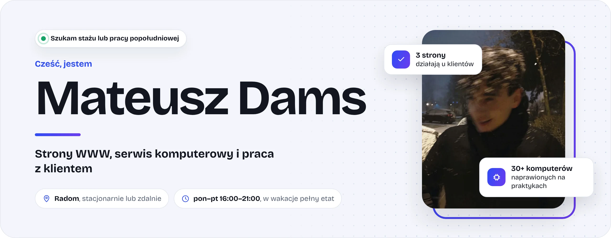</picture></a>
</p>

<p align="center">
<a href="https://mateusz-dams.github.io/"><picture><source media="(prefers-color-scheme: dark)" srcset="assets/img/readme/przycisk-portfolio-ciemny.png">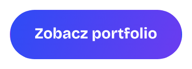</picture></a>
<a href="cv/CV-Mateusz-Dams.pdf"><picture><source media="(prefers-color-scheme: dark)" srcset="assets/img/readme/przycisk-cv-ciemny.png">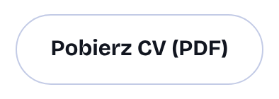</picture></a>
<a href="mailto:dams.mateusz@gmail.com"><picture><source media="(prefers-color-scheme: dark)" srcset="assets/img/readme/przycisk-mail-ciemny.png">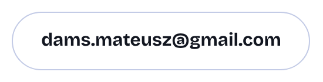</picture></a>
</p>

<p align="center"><sub>tel. 505 309 362 · Radom, stacjonarnie lub zdalnie</sub></p>

<br>

<p align="center"><picture><source media="(prefers-color-scheme: dark)" srcset="assets/img/readme/naglowek-o-mnie-ciemny.png"></picture></p>

<p align="center"><a href="https://mateusz-dams.github.io/#o-mnie"><picture><source media="(prefers-color-scheme: dark)" srcset="assets/img/readme/o-mnie-ciemny.webp">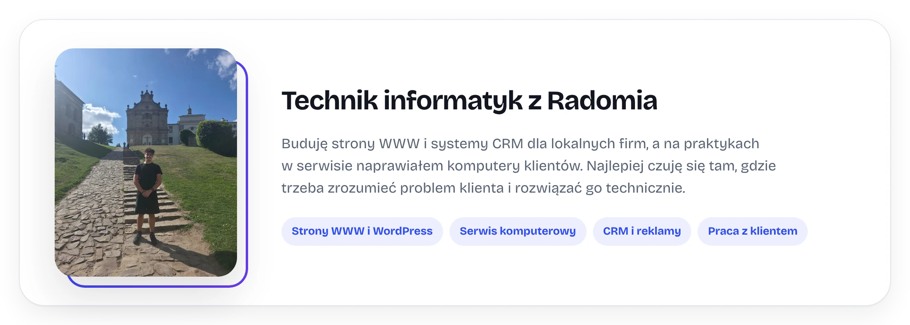</picture></a></p>

<br>

<p align="center"><picture><source media="(prefers-color-scheme: dark)" srcset="assets/img/readme/naglowek-doswiadczenie-ciemny.png"></picture></p>

<p align="center"><a href="https://mateusz-dams.github.io/#doswiadczenie"><picture><source media="(prefers-color-scheme: dark)" srcset="assets/img/readme/doswiadczenie-ciemny.webp">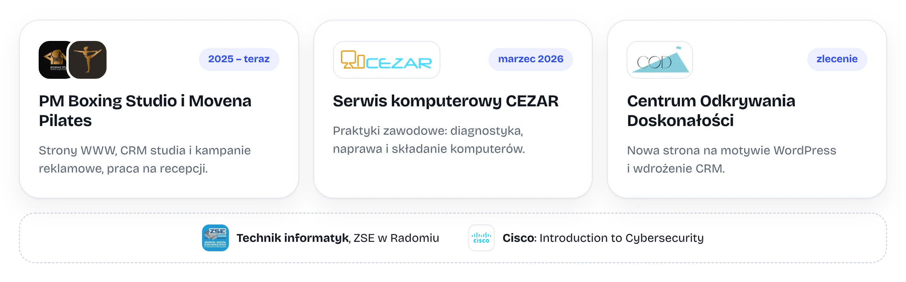</picture></a></p>

<br>

<p align="center"><picture><source media="(prefers-color-scheme: dark)" srcset="assets/img/readme/naglowek-projekty-ciemny.png"></picture></p>

<p align="center">
<a href="https://mateusz-dams.github.io/projekty/pm-boxing.html"><picture><source media="(prefers-color-scheme: dark)" srcset="assets/img/readme/projekt-pm-boxing-ciemny.webp">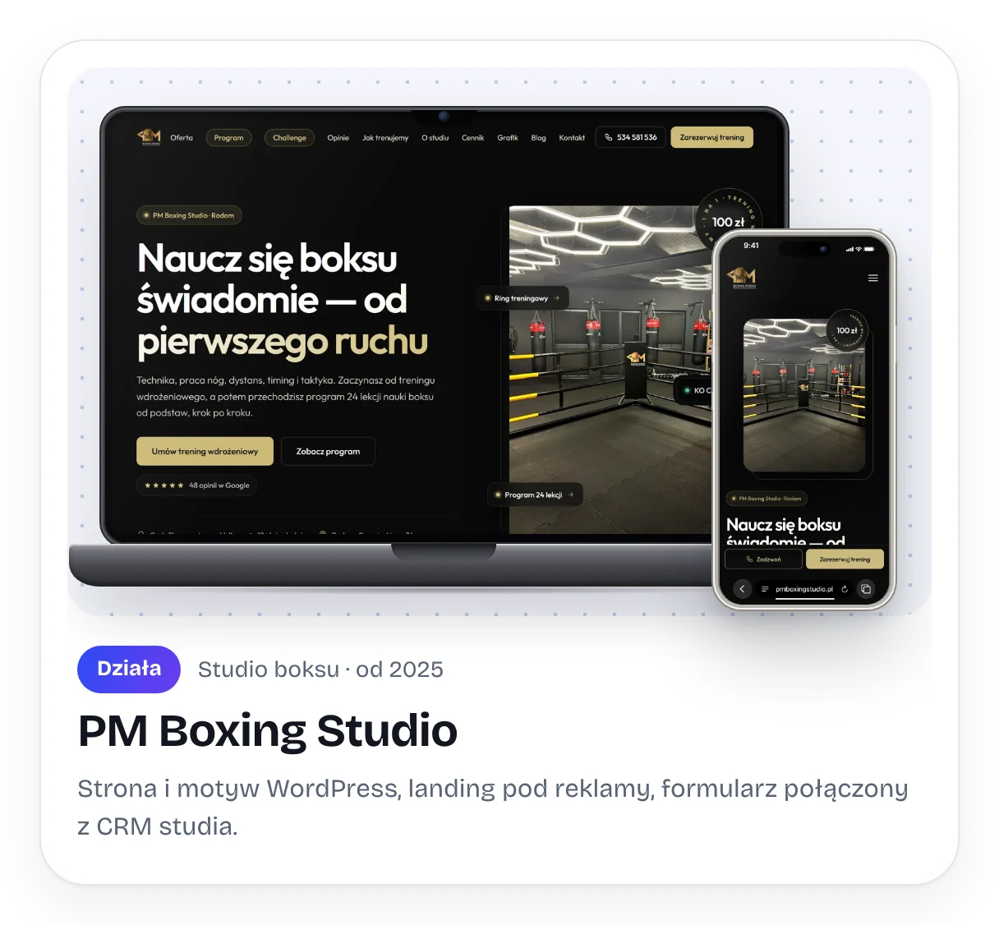</picture></a>
<a href="https://mateusz-dams.github.io/projekty/movena.html"><picture><source media="(prefers-color-scheme: dark)" srcset="assets/img/readme/projekt-movena-ciemny.webp">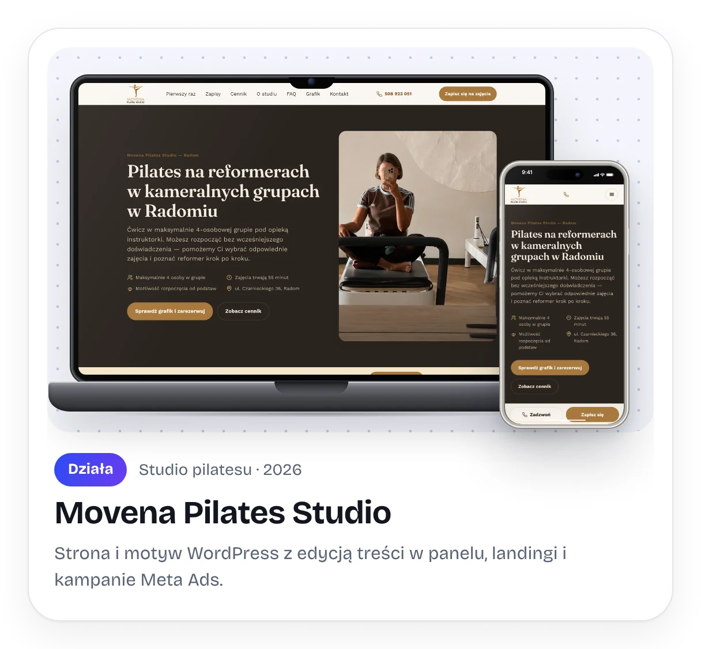</picture></a>
<a href="https://mateusz-dams.github.io/projekty/cod.html"><picture><source media="(prefers-color-scheme: dark)" srcset="assets/img/readme/projekt-cod-ciemny.webp">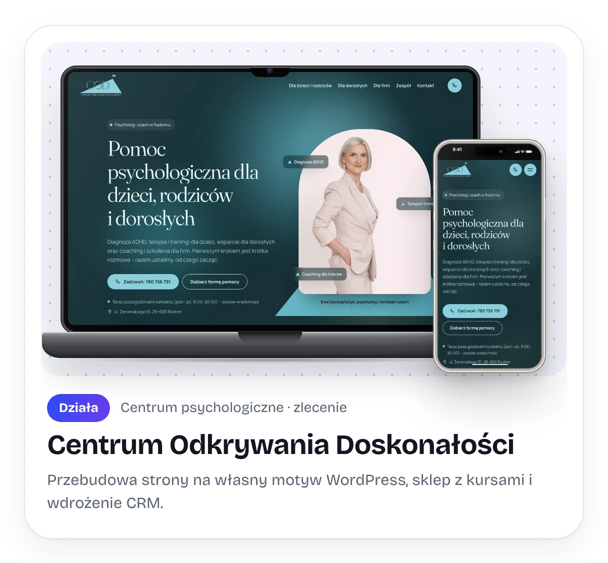</picture></a>
<a href="https://mateusz-dams.github.io/projekty/bizzlife.html"><picture><source media="(prefers-color-scheme: dark)" srcset="assets/img/readme/projekt-bizzlife-ciemny.webp">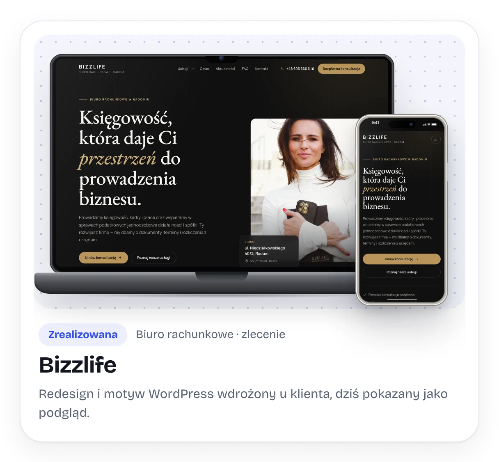</picture></a>
</p>

Każdy projekt ma w swoim folderze opis „Mój udział” (cel, mój zakres, sposób sprawdzenia przed publikacją i efekt), statyczną kopię strony, zrzuty ekranu i wybrane fragmenty kodu motywu: [PM Boxing Studio](pm-boxing/) · [Movena Pilates Studio](movena/) · [Centrum Odkrywania Doskonałości](cod/) · [Bizzlife](bizzlife/). Pełne motywy nie są publikowane, a kod nie zawiera kluczy, tokenów, adresów CRM ani identyfikatorów pomiaru.

<br>

<p align="center"><picture><source media="(prefers-color-scheme: dark)" srcset="assets/img/readme/naglowek-cwiczenia-ciemny.png"></picture></p>

<p align="center">
<a href="https://mateusz-dams.github.io/cwiczenia/topblind.html"><picture><source media="(prefers-color-scheme: dark)" srcset="assets/img/readme/cwiczenie-topblind-ciemny.webp">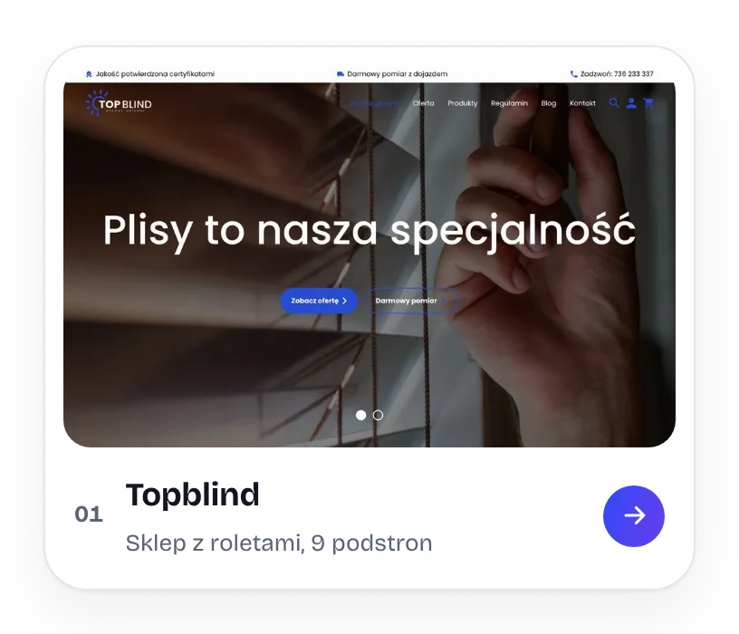</picture></a>
<a href="https://mateusz-dams.github.io/cwiczenia/austrowaren.html"><picture><source media="(prefers-color-scheme: dark)" srcset="assets/img/readme/cwiczenie-austrowaren-ciemny.webp">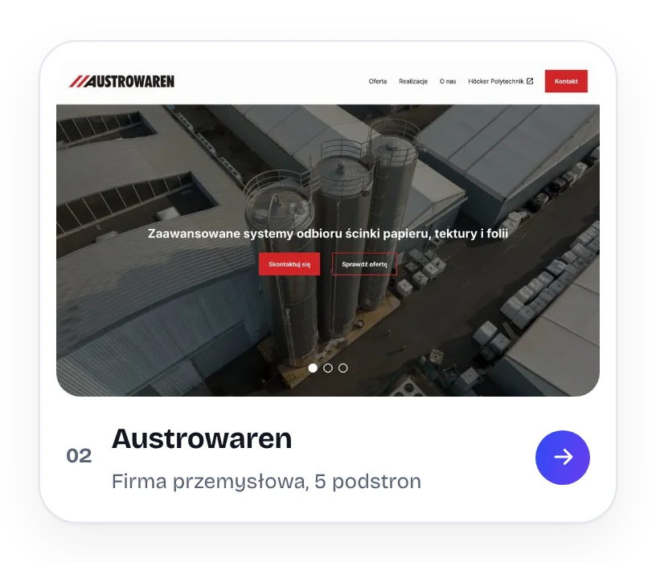</picture></a>
<a href="https://mateusz-dams.github.io/cwiczenia/silvermedica.html"><picture><source media="(prefers-color-scheme: dark)" srcset="assets/img/readme/cwiczenie-silvermedica-ciemny.webp">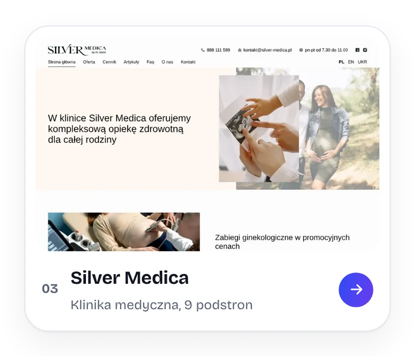</picture></a>
</p>
<p align="center">
<a href="https://mateusz-dams.github.io/cwiczenia/azs.html"><picture><source media="(prefers-color-scheme: dark)" srcset="assets/img/readme/cwiczenie-azs-ciemny.webp">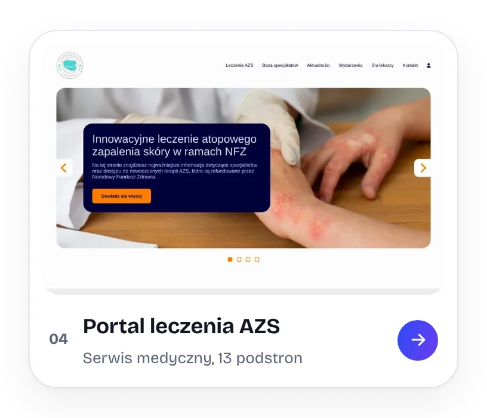</picture></a>
<a href="https://mateusz-dams.github.io/cwiczenia/leadtrust.html"><picture><source media="(prefers-color-scheme: dark)" srcset="assets/img/readme/cwiczenie-leadtrust-ciemny.webp">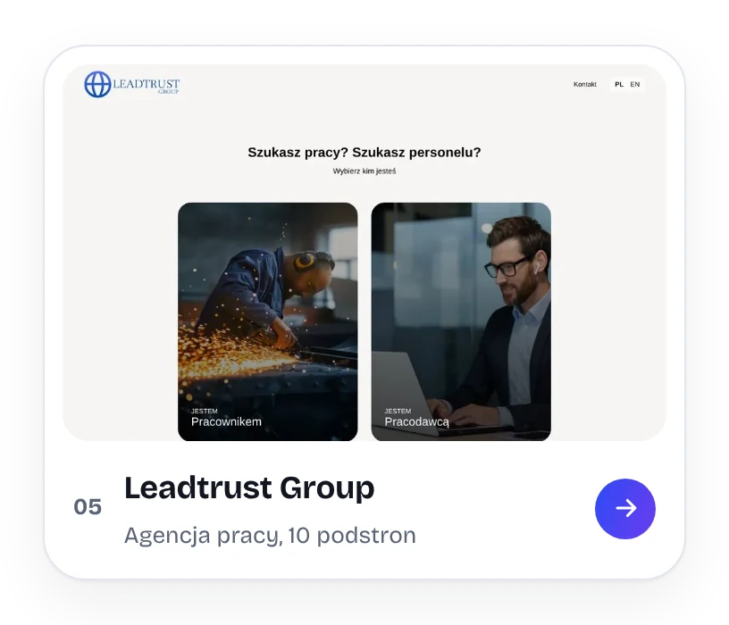</picture></a>
<a href="https://mateusz-dams.github.io/cwiczenia/staxx.html"><picture><source media="(prefers-color-scheme: dark)" srcset="assets/img/readme/cwiczenie-staxx-ciemny.webp">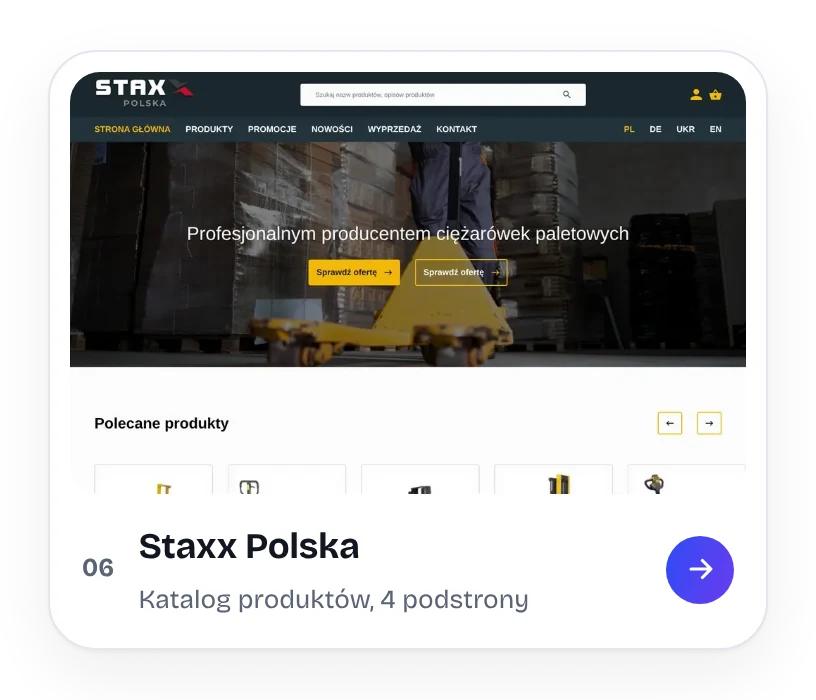</picture></a>
</p>

Każde ćwiczenie ma w portfolio podstronę z podglądem na żywo: stronę można przełączyć na widok komputera, tabletu i telefonu oraz otworzyć dowolną z zakodowanych podstron. Kod ćwiczeń: [Topblind](topblind/) · [Austrowaren](austrowaren/) · [Silver Medica](silvermedica/) · [Portal leczenia AZS](azs/) · [Leadtrust Group](leadtrust/) · [Staxx Polska](staxx/). Elementy spoza zakresu ćwiczenia (wysyłka formularzy, wyszukiwanie, przełącznik języka) pokazują komunikat zamiast prowadzić donikąd.

<br>

<p align="center"><picture><source media="(prefers-color-scheme: dark)" srcset="assets/img/readme/naglowek-budowa-ciemny.png"></picture></p>

- HTML, CSS i JavaScript bez bibliotek i frameworków, każde w osobnym folderze.
- Nazwy klas według BEM, opisowe nazwy sekcji (`about-me`, `practice-sites`, `client-brief`), selektory poprzedzone blokiem sekcji.
- Media query zawsze pod regułą, której dotyczą. Progi: 1600, 1200, 992, 768, 576 i 360 px.
- Na telefonie i tablecie układ kafelków (bento) i dolny pasek nawigacji zamiast menu, na komputerze klasyczny układ sekcji.
- Animacje wyłączają się, gdy system prosi o ograniczenie ruchu.

<details>
<summary><b>Podgląd na własnym komputerze</b></summary>

<br>

Wszystkie podglądy to zwykłe pliki HTML. Wystarczy pobrać repozytorium i w jego folderze uruchomić prosty serwer:

```
python3 -m http.server 8000
```

a potem otworzyć `http://localhost:8000/`.

</details>

<details>
<summary><b>Struktura repozytorium</b></summary>

<br>

```
index.html          strona główna portfolio
projekty/           podstrony projektów dla firm
cwiczenia/          podstrony projektów treningowych z podglądem na żywo
css/, js/           style i skrypty portfolio
assets/             zdjęcia, ikony, logotypy, czcionki, grafiki do README
                    i wspólne dodatki do projektów treningowych
cv/                 CV w PDF
cod/, pm-boxing/, movena/, bizzlife/
  ├── README.md     opis projektu i mój udział
  ├── kod-motywu/   wybrane fragmenty kodu motywu
  ├── zrzuty/       zrzuty ekranu
  └── …             statyczna kopia strony
topblind/, austrowaren/, silvermedica/, azs/, leadtrust/, staxx/
                    projekty treningowe
```

</details>

<br>

<sub>Fragmenty kodu motywów WordPress są pokazane wyłącznie do wglądu. Prawa do motywów, treści i zdjęć należą do firm, dla których powstały (zobacz [LICENSE](LICENSE)). Projekty graficzne ćwiczeń: agencja Ajmer.</sub>
