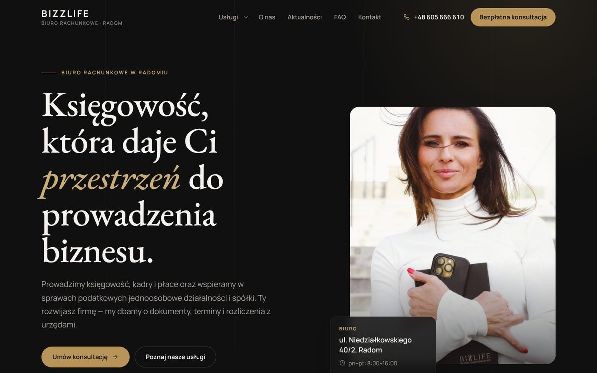
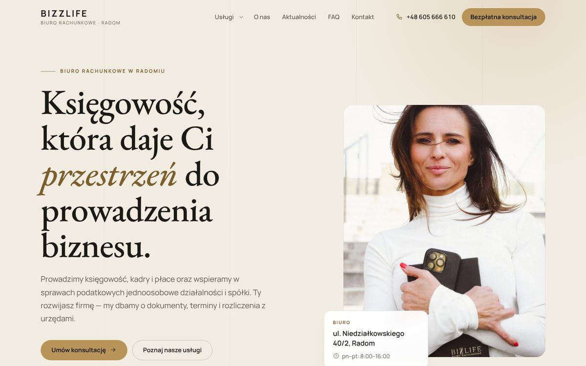
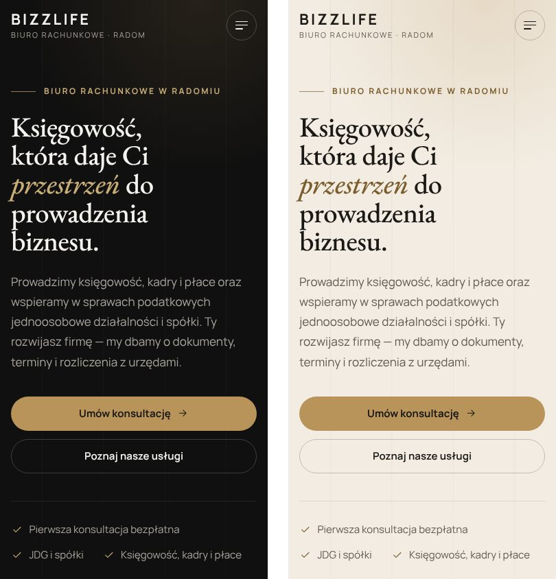
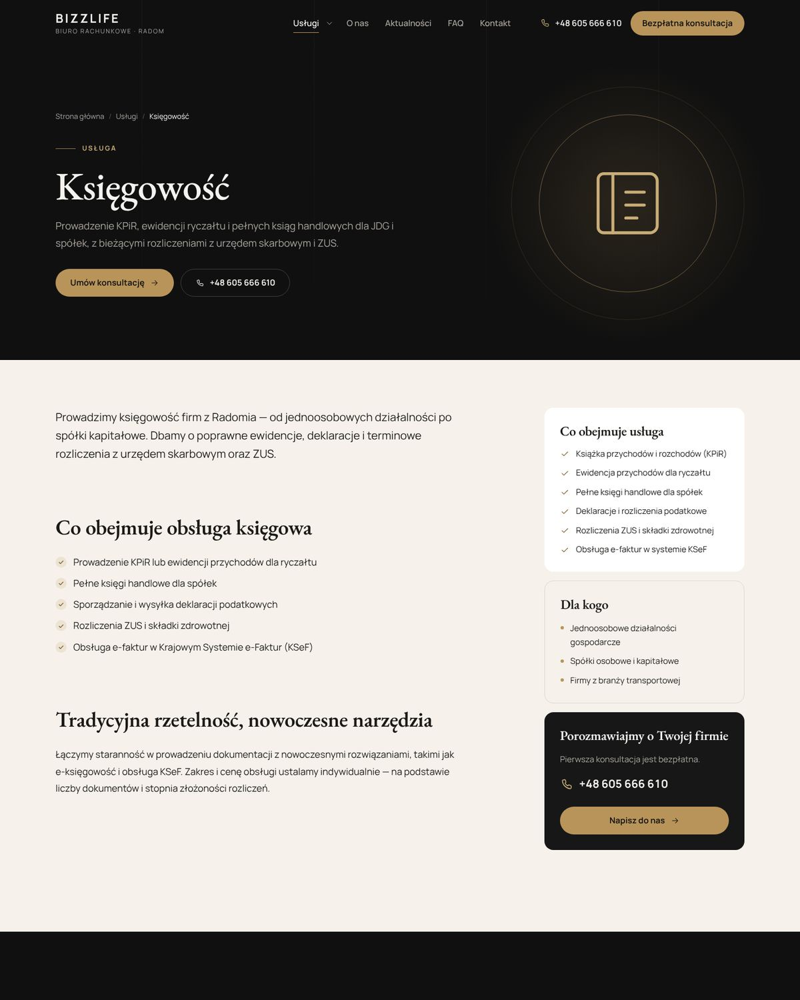

# Bizzlife – motyw WordPress (redesign)

Redesign strony biura rachunkowego **Bizzlife Sp. z o.o.** z Radomia, przygotowany jako motyw WordPress w dwóch wersjach kolorystycznych: ciemnej (czerń i złoto) i jasnej (ciepła biel i złoto). Praca powstała w ramach praktyk zawodowych w październiku 2026.

Autor portfolio: Mateusz Dams · [dams.mateusz@gmail.com](mailto:dams.mateusz@gmail.com) · [portfolio](https://mateusz-dams.github.io/)

| | |
|---|---|
| **Wersja ciemna** | [mateusz-dams.github.io/bizzlife](https://mateusz-dams.github.io/bizzlife/) |
| **Wersja jasna** | [mateusz-dams.github.io/bizzlife/jasna](https://mateusz-dams.github.io/bizzlife/jasna/) |
| **Paczki motywu** | [bizlife-premium.zip](motyw/bizlife-premium.zip) i [bizlife-premium-light.zip](motyw/bizlife-premium-light.zip) – instalacja w *Wygląd → Motywy → Dodaj nowy → Wyślij motyw* |

Podgląd to statyczna kopia wygenerowana z motywu uruchomionego na WordPressie. Formularz kontaktowy działa w trybie demonstracyjnym i niczego nie wysyła. Redesign nie jest jeszcze wdrożony na bizzlife.pl.

## Co robi motyw

- **Natywny WordPress, bez page buildera i bez wymaganych wtyczek** – teksty, zdjęcia, kolejność i tło sekcji strony głównej edytuje się w panelu *Dostosuj*.
- **Treści startowe tworzą się same po aktywacji**: 7 usług z własnymi podstronami, 14 pytań FAQ w tematach, strony O nas, Kontakt, FAQ i Aktualności oraz menu. Kreator w panelu może przenieść treść ze starych podstron i ustawić przekierowania 301.
- **Usługi i FAQ jako osobne typy treści**, z polami „Zakres usługi”, „Dla kogo” i powiązanym tematem pytań.
- **Formularz kontaktowy** z walidacją na żywo i ochroną przed spamem (nonce odświeżany przy stronach z cache, honeypot, pułapka czasowa, limit wiadomości z jednego IP). Kopia każdego zgłoszenia trafia do panelu i jest automatycznie usuwana po ustalonym czasie.
- **SEO**: własne meta i Open Graph wyłączane automatycznie, gdy działa Rank Math lub Yoast, dane strukturalne, okruszki, mapa przekierowań ze starych adresów.
- **Prywatność i szybkość**: fonty hostowane lokalnie (bez Google Fonts), mapa Google ładowana dopiero po kliknięciu, obrazy WebP, JavaScript ok. 10 KB bez bibliotek.
- **Dostępność**: nawigacja klawiaturą, link „Przejdź do treści”, ograniczenie animacji przy ustawieniu „ogranicz ruch”.

## Technologie

PHP 8 · WordPress 6.4+ · edytor bloków (`theme.json`) · HTML · CSS bez frameworka · JavaScript bez bibliotek · fonty Manrope i EB Garamond (licencja OFL).

| Telefon: wersja ciemna i jasna |
|---|
|  |

