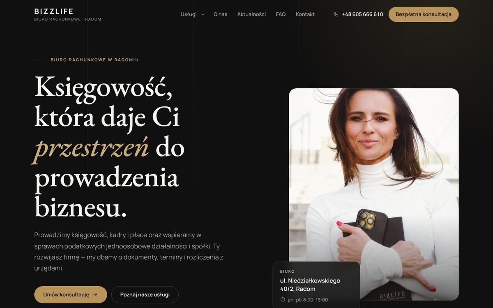
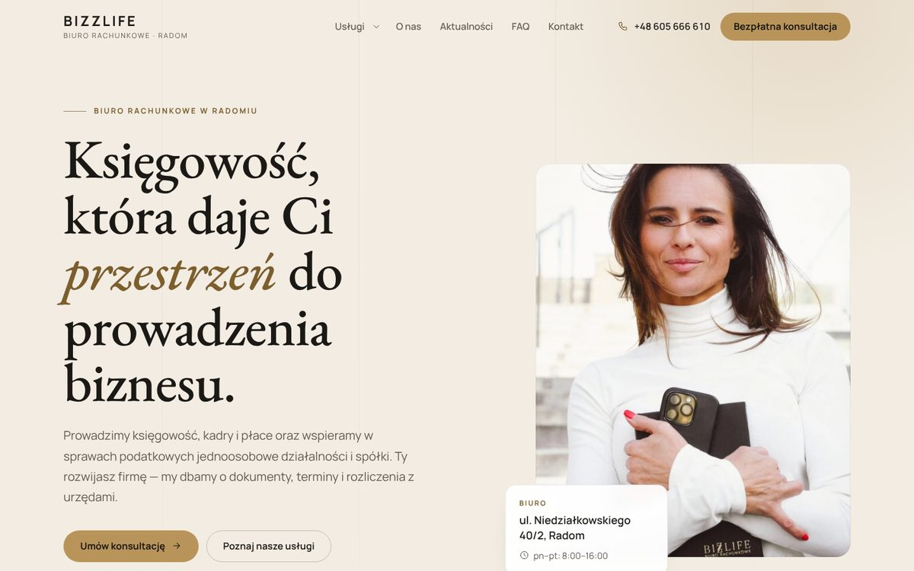
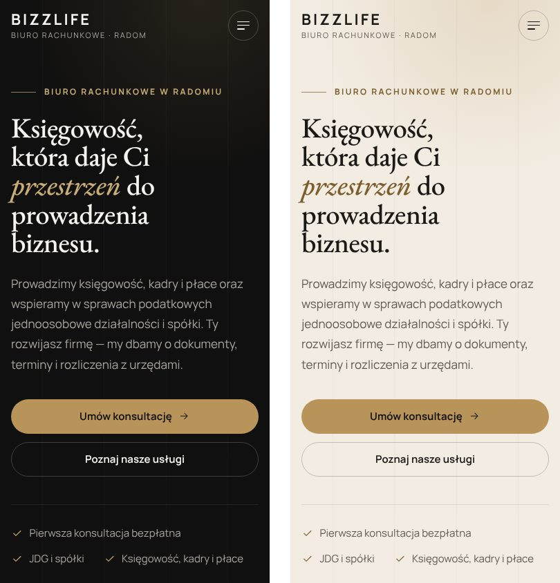
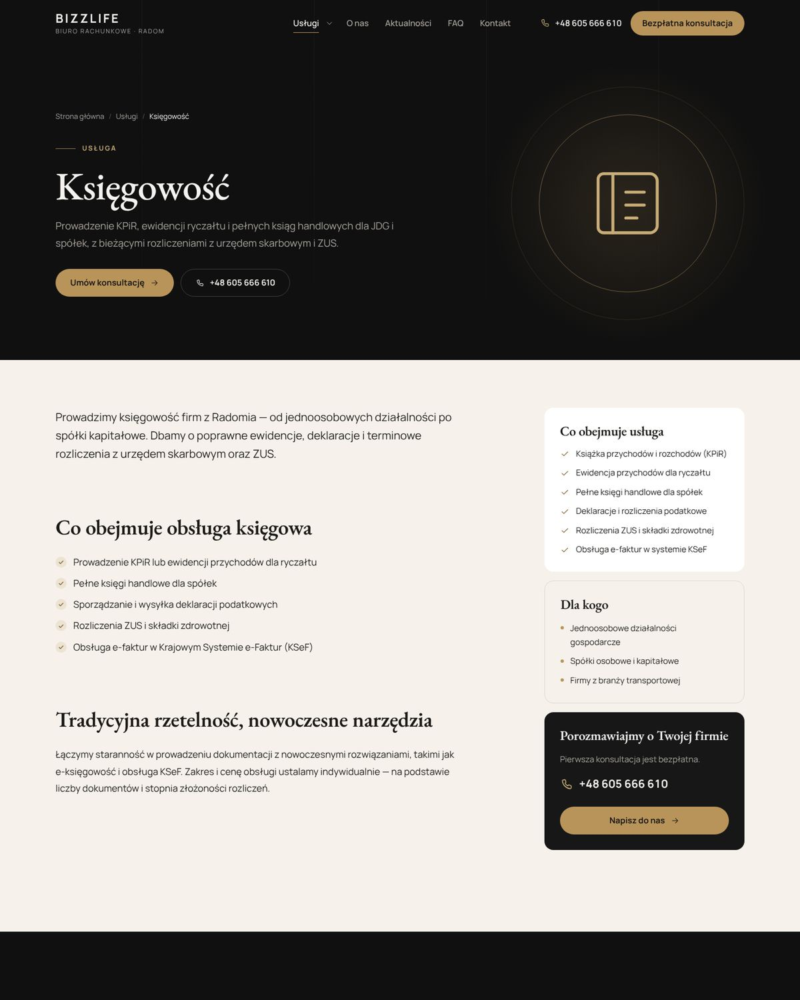

# Bizzlife – redesign i motyw WordPress

Redesign strony i motyw WordPress dla biura rachunkowego Bizzlife z Radomia, w dwóch wersjach kolorystycznych: ciemnej (czerń i złoto) i jasnej (ciepła biel i złoto). Motyw został wdrożony u klienta. Później biuro zdecydowało się na inną stronę, dlatego pod adresem bizzlife.pl działa dziś inna wersja niż ta opisana tutaj.

**Status:** Zrealizowana (wdrożona u klienta, obecnie zastąpiona inną stroną)  
**Moja rola:** projekt strony (redesign), motyw WordPress w dwóch wersjach kolorystycznych, instalacja i wdrożenie u klienta  
**Narzędzia:** kod pisany z pomocą narzędzi AI, kluczowe decyzje projektowe po stronie zleceniodawcy

| | |
|---|---|
| **Podstrona w portfolio** | [mateusz-dams.github.io/projekty/bizzlife.html](https://mateusz-dams.github.io/projekty/bizzlife.html) – zlecenie, rozwiązanie i galeria |
| **Podgląd na żywo** | [wersja ciemna](https://mateusz-dams.github.io/bizzlife/) · [wersja jasna](https://mateusz-dams.github.io/bizzlife/jasna/) – statyczne kopie wygenerowane z motywu |
| **Kod** | [kod-motywu](kod-motywu) – 5 wybranych plików motywu z opisem, do wglądu |

## Mój udział

| | |
|---|---|
| **Cel** | Nowoczesna strona biura rachunkowego, która jasno pokazuje usługi i zachęca do kontaktu, a biuro może ją edytować samo, bez page buildera. |
| **Mój zakres** | Nowy projekt strony (redesign) i motyw WordPress w dwóch wersjach kolorystycznych, z treściami startowymi tworzonymi automatycznie. Kod pisałem z pomocą narzędzi AI. Kluczowe decyzje projektowe należały do zleceniodawcy. |
| **Weryfikacja** | Wszystkie 19 podstron sprawdzone w przeglądarce na komputerze i telefonie: brak błędów skryptów, brak przewijania w bok, działające linki i kotwice, formularz w trybie pokazowym. |
| **Efekt** | Motyw wdrożony u klienta. Biuro później zastąpiło go inną stroną, więc ten projekt można dziś obejrzeć w podglądzie z linków powyżej. |

## Co robi motyw

- **Natywny WordPress, bez page buildera i bez wymaganych wtyczek** – teksty, zdjęcia, kolejność i tło sekcji strony głównej edytuje się w panelu *Dostosuj*.
- **Treści startowe tworzą się same po aktywacji**: 7 usług z własnymi podstronami, 14 pytań FAQ w tematach, strony O nas, Kontakt, FAQ i Aktualności oraz menu. Kreator w panelu może przenieść treść ze starych podstron i ustawić przekierowania 301.
- **Usługi i FAQ jako osobne typy treści**, z polami „Zakres usługi”, „Dla kogo” i powiązanym tematem pytań.
- **Formularz kontaktowy** z walidacją na żywo i ochroną przed spamem (nonce odświeżany przy stronach z cache, honeypot, pułapka czasowa, limit wiadomości z jednego IP). Kopia każdego zgłoszenia trafia do panelu i jest automatycznie usuwana po ustalonym czasie.
- **SEO**: własne meta i Open Graph wyłączane automatycznie, gdy działa Rank Math lub Yoast, dane strukturalne, okruszki, mapa przekierowań ze starych adresów.
- **Prywatność i szybkość**: fonty hostowane lokalnie (bez Google Fonts), mapa Google ładowana dopiero po kliknięciu, obrazy WebP, JavaScript ok. 10 KB bez bibliotek.
- **Dostępność**: nawigacja klawiaturą, link „Przejdź do treści”, ograniczenie animacji przy ustawieniu „ogranicz ruch”.

## Technologie

PHP 8 · WordPress 6.4+ · edytor bloków (`theme.json`) · HTML · CSS bez frameworka · JavaScript bez bibliotek · fonty Manrope i EB Garamond (licencja OFL).

| Telefon: wersja ciemna i jasna |
|---|
|  |

## O podglądzie na żywo

Podgląd to statyczny HTML wygenerowany z tego motywu uruchomionego na WordPressie – ten sam kod i wygląd, bez bazy danych. Formularz kontaktowy sprawdza pola, ale działa w trybie pokazowym i niczego nie wysyła. Kopia ma znacznik `noindex`, żeby nie konkurowała w wyszukiwarce ze stroną biura.

## O kodzie

W folderze `kod-motywu` jest 5 wybranych plików z opisem, co pokazuje każdy z nich. Pełny motyw nie jest publikowany. Kod jest wyłącznie do wglądu (zobacz [LICENSE](../LICENSE)) i nie zawiera kluczy, tokenów, adresów CRM ani identyfikatorów pomiaru.

---

Projekt wykonany dla: Biuro rachunkowe Bizzlife, Radom. Zdjęcia i treści należą do klienta.  
Mateusz Dams · [dams.mateusz@gmail.com](mailto:dams.mateusz@gmail.com) · [portfolio](https://mateusz-dams.github.io/)
