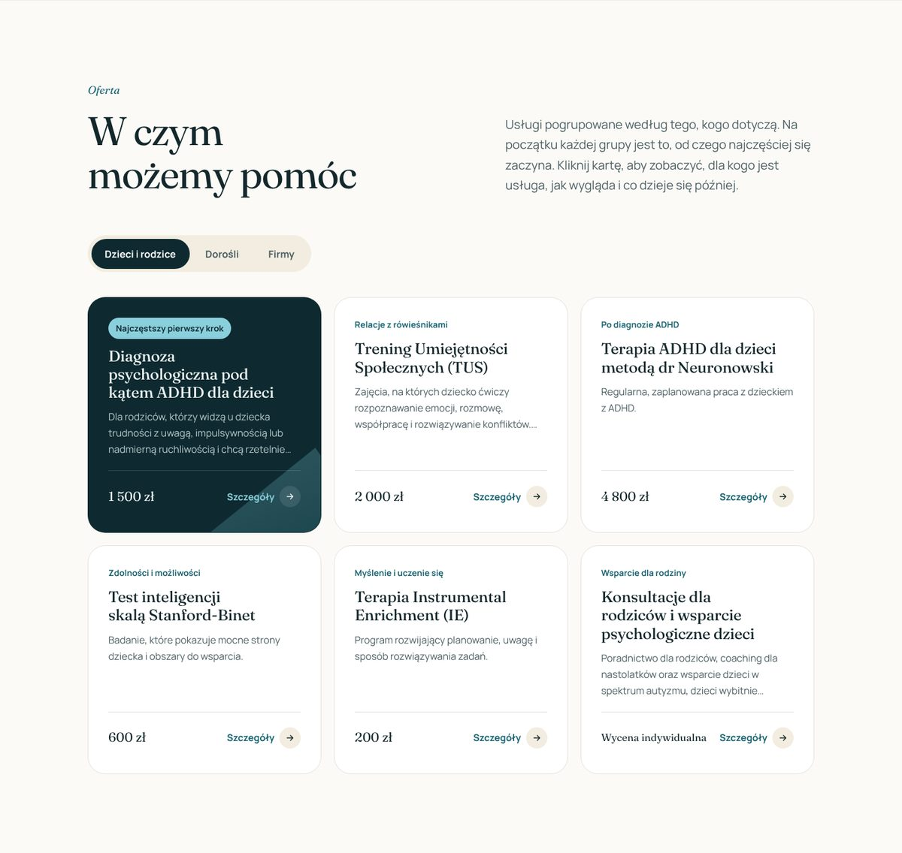
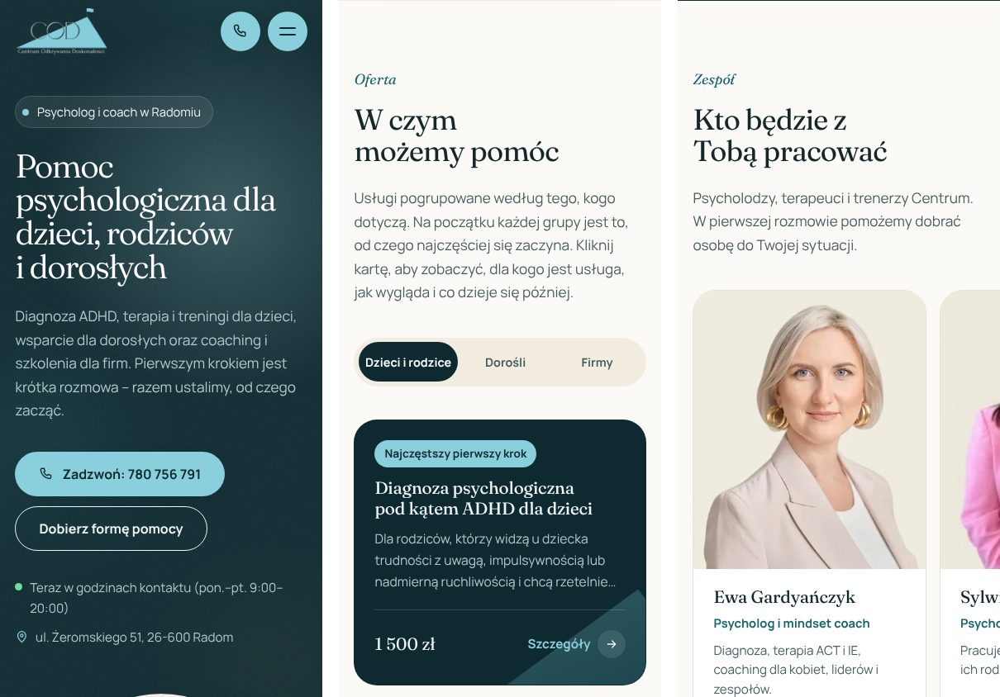
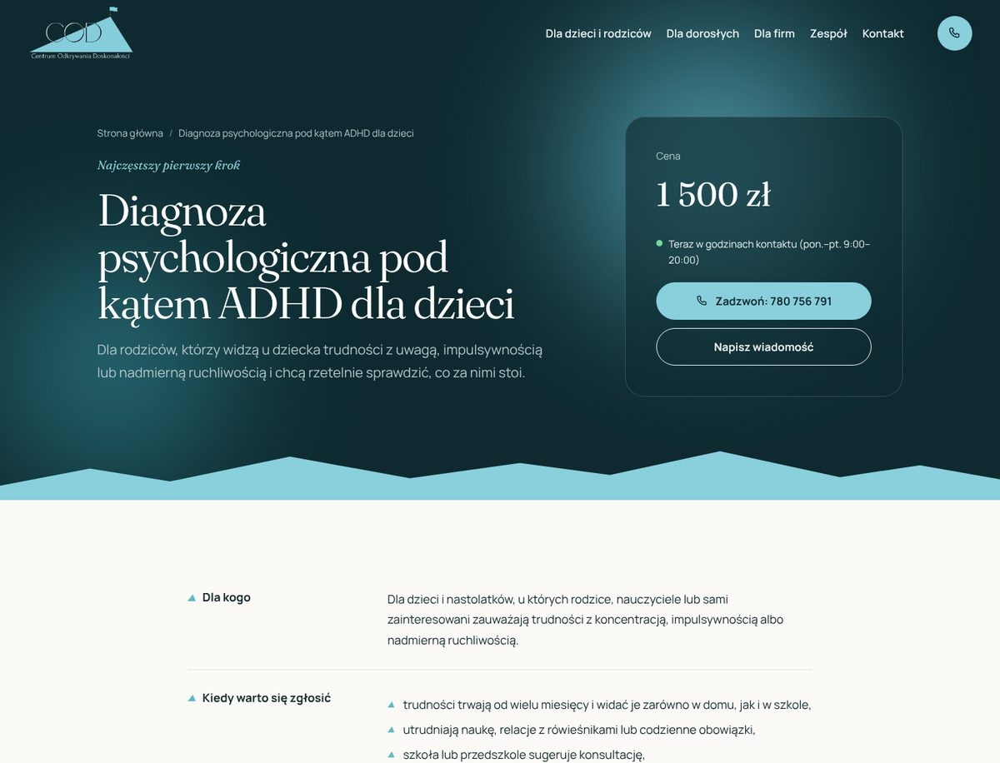

# Centrum Odkrywania Doskonałości – motyw WordPress

Autorski motyw WordPress dla Centrum Odkrywania Doskonałości, centrum psychologicznego w Radomiu (diagnoza ADHD, terapia i treningi dla dzieci, wsparcie dla dorosłych, coaching i szkolenia dla firm).

**Projekt i wdrożenie:** Mateusz Dams · [dams.mateusz@gmail.com](mailto:dams.mateusz@gmail.com) · [portfolio](https://mateusz-dams.github.io/)

| | |
|---|---|
| **Podgląd na żywo** | [mateusz-dams.github.io/cod](https://mateusz-dams.github.io/cod/) – statyczna kopia wygenerowana z motywu |
| **Strona klienta** | [cod.biz.pl](https://cod.biz.pl/) – motyw w działaniu na produkcji |
| **Paczka motywu** | [cod-2026.zip](cod-2026.zip) – do instalacji w *Wygląd → Motywy → Dodaj nowy → Wyślij motyw* |


## Co robi motyw

- **Kreator „Od czego zacząć?”** – dwa pytania (kogo dotyczy sprawa i co jest najważniejsze) i propozycja pierwszej usługi z ceną oraz przyciskami kontaktu.
- **Oferta w zakładkach** (dzieci i rodzice, dorośli, firmy) w układzie siatki, która zawsze wypełnia pełne rzędy; szczegóły usługi otwierają się w oknie, a każda usługa ma też własną podstronę.
- **Zespół, opinie, pytania (FAQ), „Jak wygląda pierwszy kontakt”** – sekcje strony głównej z tekstami edytowanymi w panelu; puste pole = tekst domyślny, więc strona nigdy nie ma „dziur”.
- **Formularz kontaktowy** z walidacją na żywo, ochroną przed spamem (nonce, honeypot, czas wypełnienia, limit z jednego IP) i wysyłką przez `wp_mail`; alternatywnie Contact Form 7.
- **Godziny kontaktu na żywo** – status „teraz w godzinach kontaktu” liczony według czasu w Polsce.
- **Tryb ciemny** włączany automatycznie według ustawień telefonu lub komputera, z osobną wersją logo.
- **Mapa Google ładowana dopiero po kliknięciu** – bez cookies przed zgodą.
- **Pomiar przez Google Tag Manager i Consent Mode v2** – 21 zdarzeń (telefon, e-mail, formularz, kreator, zakładki, FAQ…), każde z informacją o miejscu na stronie.
- **WooCommerce i LearnDash** – własne szablony sklepu, karty produktu oraz stylizacja kursów, lekcji i testów.
- **Zgodność wstecz** – motyw zastąpił poprzedni i korzysta z tych samych pól ACF, typu wpisu „Oferta” i menu, więc zmiana nie wymagała przepisywania treści. Narzędzie „Uzupełnij treści” w panelu wpisuje opisy usług tylko do pustych pól.



## Technologie

PHP 7.4–8.3 · WordPress 6.4+ · ACF PRO / Secure Custom Fields · WooCommerce · LearnDash · HTML · CSS (zmienne, tryb ciemny, bez frameworka) · JavaScript bez bibliotek · fonty Manrope i Fraunces hostowane lokalnie (bez Google Fonts).

Dostępność: nawigacja klawiaturą, link „Przejdź do treści”, poprawne role ARIA w zakładkach i oknach, ograniczenie animacji przy ustawieniu „ogranicz ruch”.

| Telefon | Tryb ciemny |
|---|---|
|  |  |



## Struktura motywu

```
cod-2026/
├── style.css, functions.php
├── header.php, footer.php, front-page.php, page.php, single.php, index.php, 404.php
├── single-offer.php, archive-offer.php, taxonomy-offer_cat.php      usługi
├── archive-sfwd-courses.php, single-sfwd-*.php                       LearnDash
├── woocommerce/                                                      sklep
├── inc/            logika: pomocnicze, ustawienia, pola ACF, zasoby, pomiar, sekcje, usługi, formularz, sklep, kursy
├── template-parts/ strona główna, 13 układów sekcji, karty, formularz
└── assets/         css, js, fonty, obrazy
```

## O podglądzie na żywo

Podgląd to statyczny HTML wygenerowany z tego motywu – ten sam kod, ten sam wygląd, bez bazy danych WordPressa. Działa w nim wszystko poza funkcjami serwera:

- formularz sprawdza pola, ale zamiast wysyłki pokazuje informację, że to kopia,
- nie ma sklepu i kursów (wymagają WooCommerce i LearnDash),
- nie ma kodów pomiaru klienta, a strona ma znacznik `noindex`, żeby nie konkurowała w wyszukiwarce z oryginałem.

Pełną wersję ze sklepem i kursami zobaczysz na [cod.biz.pl](https://cod.biz.pl/).

## Instalacja paczki

1. *Wygląd → Motywy → Dodaj nowy → Wyślij motyw* → `cod-2026.zip` → *Zainstaluj* → *Włącz*.
2. Wymagana wtyczka **Secure Custom Fields** lub **ACF PRO**; WooCommerce i LearnDash – opcjonalnie.
3. Identyfikatory pomiaru (Google Tag Manager, GA4, Google Ads, Hotjar) wpisuje się w *Opcje motywu → COD 2026 → Pomiar i cookies* – w tej paczce są puste.

Szczegóły edycji treści: plik `README.md` w paczce motywu.

---

Projekt wykonany dla Centrum Odkrywania Doskonałości, ul. Żeromskiego 51, 26-600 Radom. Zdjęcia i treści należą do klienta.
