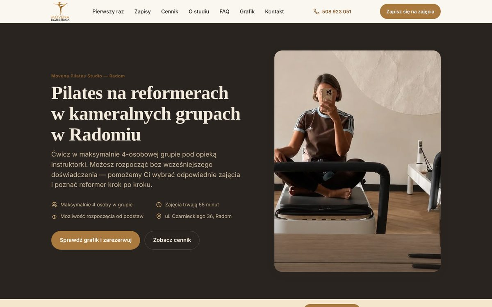
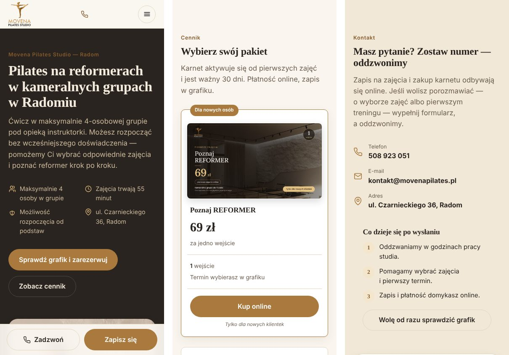

# Movena Pilates Studio – motyw WordPress

Motyw WordPress dla Movena Pilates Studio – studia pilatesu na reformerach w Radomiu (zajęcia w grupach do 4 osób).

**Projekt i wdrożenie:** Mateusz Dams · [dams.mateusz@gmail.com](mailto:dams.mateusz@gmail.com) · [portfolio](https://mateusz-dams.github.io/)

| | |
|---|---|
| **Podgląd na żywo** | [mateusz-dams.github.io/movena](https://mateusz-dams.github.io/movena/) – statyczna kopia wygenerowana z motywu |
| **Strona w działaniu** | [movenapilates.pl](https://movenapilates.pl/) |
| **Landingi pod reklamy** | [Pierwszy trening za 69 zł](https://mateusz-dams.github.io/movena/pierwszy-trening/) · [Program REFORMER 10](https://mateusz-dams.github.io/movena/reformer-10/) |

## Co robi motyw

- **Strona główna z 15 sekcji** (pierwszy raz na reformerze, kroki do pierwszego treningu, zapisy online, cennik, dlaczego mała grupa, o studiu, instruktorki, vouchery, FAQ, lokalizacja, kontakt) edytowanych w panelu (Secure Custom Fields); menu w nagłówku i stopce buduje się z kotwic sekcji.
- **Cennik pakietów z grafikami** w jednym, spójnym wzorze kart (wejście próbne, pojedyncze, karnety 4/6/8, program REFORMER 10) i sekcja voucherów prezentowych.
- **Dwa landingi pod kampanie Meta Ads** – „Pierwszy trening za 69 zł” i „Program REFORMER 10” – z własnymi sekcjami i przyciskami.
- **Zapisy i płatności przez Fitssey** z gotowym przełączeniem na własny CRM (grafik z wolnymi miejscami, zapis online) – jeden przełącznik w panelu zmienia przyciski i teksty na całej stronie.
- **Formularz „Poproś o telefon”** z walidacją, ochroną przed spamem, wysyłką SMTP i przekazywaniem leadów do CRM.
- **Mapa Google ładowana dopiero po kliknięciu**, zgoda na cookies (Consent Mode v2) dla GA4 i Meta Pixel, dane strukturalne JSON-LD, przekierowania 301 ze starej strony.
- **Strony prawne** (regulamin usług, polityka prywatności, polityka cookies) wypełniane danymi spółki z panelu.

## Technologie

PHP 7.4+ · WordPress · Secure Custom Fields · HTML · CSS bez frameworka · JavaScript bez bibliotek · integracja z Fitssey · Google Consent Mode v2 · JSON-LD.

## O podglądzie na żywo

Podgląd to statyczny HTML wygenerowany z tego motywu – ten sam kod i wygląd, bez bazy danych WordPressa. Przyciski zapisów prowadzą do prawdziwego systemu Fitssey studia; formularz sprawdza pola, ale zamiast wysyłki pokazuje informację, że to kopia. Kopia nie zawiera kodów pomiaru ani połączenia z CRM i ma znacznik `noindex`.
