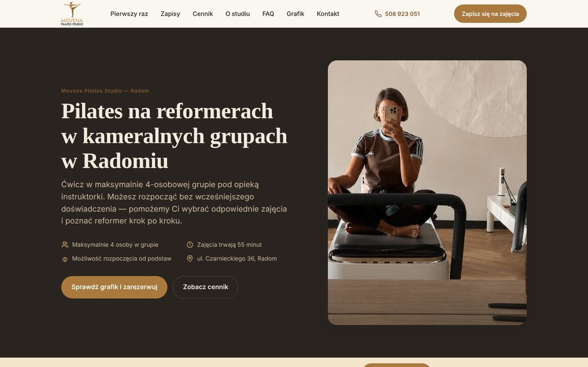
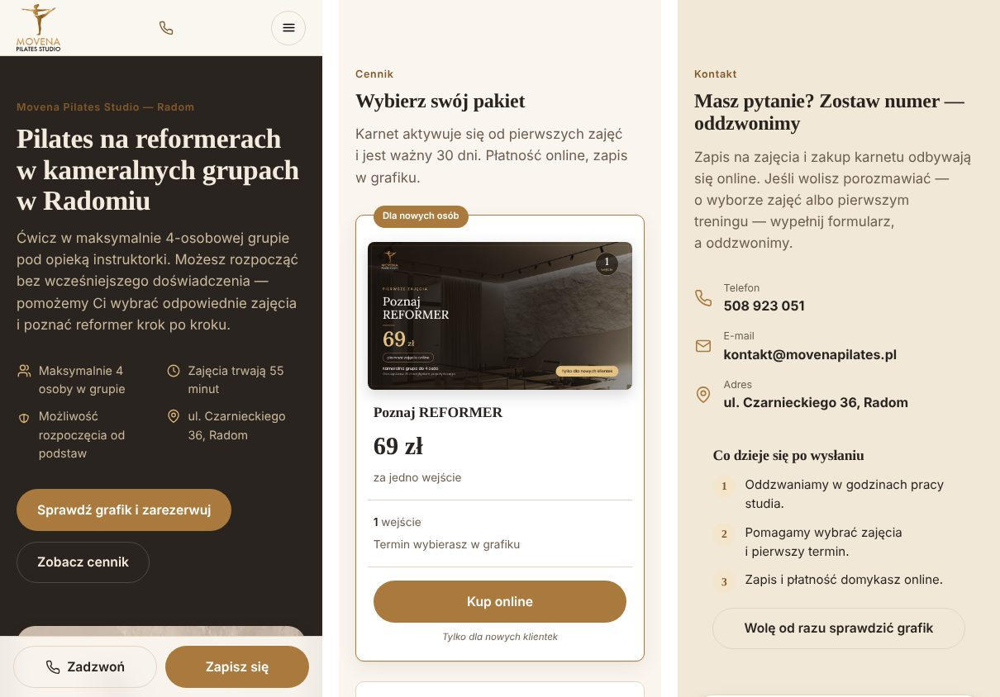

# Movena Pilates Studio – strona i motyw WordPress

Strona i motyw WordPress dla Movena Pilates Studio, studia pilatesu na reformerach w Radomiu (zajęcia w grupach do 4 osób).

**Status:** Wdrożona, działa na [movenapilates.pl](https://movenapilates.pl/)  
**Moja rola:** strona od podstaw, redesign i motyw WordPress, landingi pod reklamy, nowe funkcje CRM zintegrowane ze stroną oraz kampania Meta Ads, w zespole z właścicielem  
**Narzędzia:** kod pisany ręcznie i z pomocą narzędzi AI

| | |
|---|---|
| **Podstrona w portfolio** | [mateusz-dams.github.io/projekty/movena.html](https://mateusz-dams.github.io/projekty/movena.html) – zlecenie, rozwiązanie i galeria |
| **Podgląd na żywo** | [mateusz-dams.github.io/movena](https://mateusz-dams.github.io/movena/) – statyczna kopia wygenerowana z motywu |
| **Strona klienta** | [movenapilates.pl](https://movenapilates.pl/) – motyw w działaniu |
| **Landingi pod reklamy** | [Pierwszy trening za 69 zł](https://mateusz-dams.github.io/movena/pierwszy-trening/) · [Program REFORMER 10](https://mateusz-dams.github.io/movena/reformer-10/) |
| **Kod** | [kod-motywu](kod-motywu) – 5 wybranych plików motywu z opisem, do wglądu |

## Mój udział

| | |
|---|---|
| **Cel** | Strona nowego studia (działa od sierpnia 2026), która zbiera zapisy na pierwszy trening z kampanii reklamowych i jest gotowa na przejście z Fitssey na własny CRM. |
| **Mój zakres** | Współtworzenie strony od podstaw, a potem jej przebudowa i przeniesienie na własny motyw WordPress oparty na motywie PM Boxing. Dwa landingi pod kampanie Meta Ads, cennik pakietów z grafikami, sekcja voucherów, analityka. Prowadzenie kampanii Meta Ads: audyty, zmiany budżetów i optymalizacja. Współtworzenie systemu CRM dla studia (w fazie wdrożenia). |
| **Weryfikacja** | Testy w prawdziwym WordPressie na komputerze i telefonie: formularz (e-mail i zgłoszenie w CRM), zgoda na cookies (bez zgody nic się nie ładuje), przekazywanie parametrów kampanii do linków zapisów, przekierowania 301. |
| **Efekt** | Strona nowego studia działa od otwarcia w sierpniu 2026 na [movenapilates.pl](https://movenapilates.pl/). Kampanie Meta Ads z landingami dały ok. 100 zgłoszeń w 3 miesiące przy koszcie ok. 23 zł za zgłoszenie. |

## Co robi motyw

- **Strona główna z 15 sekcji** (pierwszy raz na reformerze, kroki do pierwszego treningu, zapisy online, cennik, dlaczego mała grupa, o studiu, instruktorki, vouchery, FAQ, lokalizacja, kontakt) edytowanych w panelu (Secure Custom Fields); menu w nagłówku i stopce buduje się z kotwic sekcji.
- **Cennik pakietów z grafikami** w jednym, spójnym wzorze kart (wejście próbne, pojedyncze, karnety 4/6/8, program REFORMER 10) i sekcja voucherów prezentowych.
- **Dwa landingi pod kampanie Meta Ads** – „Pierwszy trening za 69 zł” i „Program REFORMER 10” – z własnymi sekcjami i przyciskami.
- **Zapisy i płatności przez Fitssey** z gotowym przełączeniem na własny CRM (grafik z wolnymi miejscami, zapis online) – jeden przełącznik w panelu zmienia przyciski i teksty na całej stronie.
- **Formularz „Poproś o telefon”** z walidacją, ochroną przed spamem, wysyłką SMTP i przekazywaniem leadów do CRM.
- **Mapa Google ładowana dopiero po kliknięciu**, zgoda na cookies (Consent Mode v2) dla GA4 i Meta Pixel, dane strukturalne JSON-LD, przekierowania 301 ze starej strony.
- **Strony prawne** (regulamin usług, polityka prywatności, polityka cookies) wypełniane danymi spółki z panelu.

## Technologie

PHP 7.4+ · WordPress · Secure Custom Fields · HTML · CSS bez frameworka · JavaScript bez bibliotek · integracja z Fitssey · Google Consent Mode v2 · JSON-LD.

## O podglądzie na żywo

Podgląd to statyczny HTML wygenerowany z tego motywu – ten sam kod i wygląd, bez bazy danych WordPressa. Przyciski zapisów prowadzą do prawdziwego systemu Fitssey studia; formularz sprawdza pola, ale zamiast wysyłki pokazuje informację, że to kopia. Kopia nie zawiera kodów pomiaru ani połączenia z CRM i ma znacznik `noindex`.

## O kodzie

W folderze `kod-motywu` jest 5 wybranych plików z opisem, co pokazuje każdy z nich. Pełny motyw nie jest publikowany. Kod jest wyłącznie do wglądu (zobacz [LICENSE](../LICENSE)) i nie zawiera kluczy, tokenów, adresów CRM ani identyfikatorów pomiaru.

---

Projekt wykonany dla: Movena Pilates Studio, Radom. Zdjęcia i treści należą do klienta.  
Mateusz Dams · [dams.mateusz@gmail.com](mailto:dams.mateusz@gmail.com) · [portfolio](https://mateusz-dams.github.io/)
