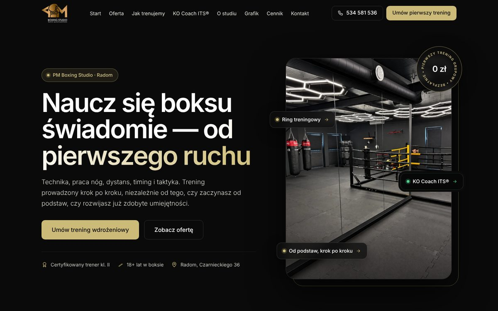
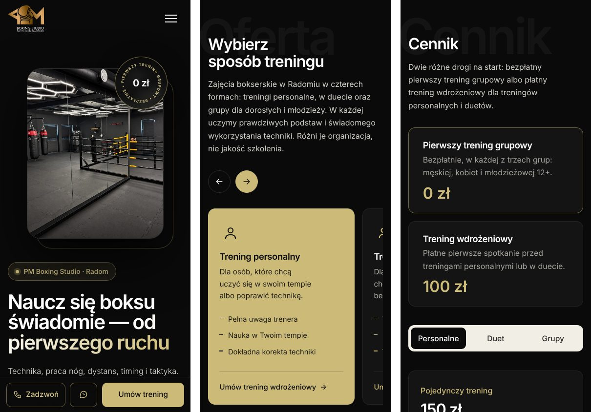

# PM Boxing Studio – strona i motyw WordPress

Strona i motyw WordPress dla PM Boxing Studio, studia boksu w Radomiu (treningi personalne, w duecie i grupowe dla dorosłych oraz młodzieży 12+).

**Status:** Wdrożona, działa na [pmboxingstudio.pl](https://pmboxingstudio.pl/)  
**Moja rola:** strona i motyw WordPress, rozwijanie, testowanie i wdrażanie firmowego CRM oraz kampanie reklamowe, w zespole z właścicielem  
**Narzędzia:** kod pisany ręcznie i z pomocą narzędzi AI (Claude)

| | |
|---|---|
| **Podstrona w portfolio** | [mateusz-dams.github.io/projekty/pm-boxing.html](https://mateusz-dams.github.io/projekty/pm-boxing.html) – zlecenie, rozwiązanie i galeria |
| **Podgląd na żywo** | [mateusz-dams.github.io/pm-boxing](https://mateusz-dams.github.io/pm-boxing/) – statyczna kopia wygenerowana z motywu |
| **Strona klienta** | [pmboxingstudio.pl](https://pmboxingstudio.pl/) – motyw w działaniu |
| **Landing pod reklamy** | [Trening wdrożeniowy](https://mateusz-dams.github.io/pm-boxing/trening-wdrozeniowy/) |
| **Kod** | [kod-motywu](kod-motywu) – 5 wybranych plików motywu z opisem, do wglądu |

## Mój udział

| | |
|---|---|
| **Cel** | Strona, która zamienia odwiedzających w zapisy na pierwszy trening, i którą właściciel studia edytuje sam, bez programisty. |
| **Mój zakres** | Współtworzenie strony od podstaw (najpierw HTML, CSS i JS), a potem jej przebudowa i przeniesienie na własny motyw WordPress z treściami w panelu (Secure Custom Fields). Landing pod kampanie reklamowe, formularz przekazujący zgłoszenia do CRM studia, wdrożenie analityki (Google Tag Manager, GA4, Meta Pixel ze zgodą na cookies), Search Console i Profil firmy w Google. Współtworzenie, wdrażanie i testowanie systemu CRM, z którego studio korzysta na co dzień. |
| **Weryfikacja** | Testy na komputerze i telefonie, wysyłka formularza z podglądem zgłoszenia w CRM, sprawdzenie zdarzeń w podglądzie GA4 i Meta, przekierowania 301 ze starych adresów. |
| **Efekt** | Strona działa na [pmboxingstudio.pl](https://pmboxingstudio.pl/). Właściciel sam zmienia treści w panelu, bez programisty, a zgłoszenia z formularza trafiają od razu do CRM studia. |

## Co robi motyw

- **Strona główna z 17 sekcji** (oferta, pierwszy krok, dla kogo, metoda treningu, KO Coach ITS®, o studiu, inspiracje, sala, opinie, grafik, cennik, partnerzy, FAQ, kontakt) – każda sekcja to blok edytowany w panelu (Secure Custom Fields), a **menu buduje się samo z kotwic sekcji**, identyczne w nagłówku i stopce.
- **Landing pod kampanie reklamowe** (`/trening-wdrozeniowy/`) z własnym zestawem sekcji, skupiony na jednym celu – płatnym pierwszym treningu.
- **Cennik w zakładkach** (personalne, duet, grupy) i grafik zajęć grupowych.
- **Formularz zgłoszeń** z walidacją, ochroną przed spamem (honeypot, czas wypełnienia, limit z jednego IP), wysyłką przez SMTP, automatyczną odpowiedzią i **przekazywaniem leadów do własnego CRM**.
- **Zgoda na cookies (Consent Mode v2)** – GA4, Google Ads i Meta Pixel ładują się dopiero po zgodzie; zdarzenia konwersji z formularza i telefonów.
- **SEO:** tytuły i opisy z panelu, Open Graph, dane strukturalne JSON-LD (firma, godziny otwarcia, FAQ).
- **Strony prawne** (polityka prywatności, regulamin, polityka cookies) wypełnione danymi spółki od razu po instalacji.
- Pełna treść domyślna w motywie – po instalacji strona jest kompletna, bez ręcznego uzupełniania.

## Technologie

PHP 7.4+ · WordPress · Secure Custom Fields (pola elastyczne) · HTML · CSS bez frameworka · JavaScript bez bibliotek · Google Consent Mode v2 · JSON-LD.

## O podglądzie na żywo

Podgląd to statyczny HTML wygenerowany z tego motywu – ten sam kod i wygląd, bez bazy danych WordPressa. Formularz sprawdza pola, ale zamiast wysyłki pokazuje informację, że to kopia. Kopia nie zawiera kodów pomiaru ani połączenia z CRM i ma znacznik `noindex`, żeby nie konkurowała w wyszukiwarce z oryginałem.

## O kodzie

W folderze `kod-motywu` jest 5 wybranych plików z opisem, co pokazuje każdy z nich. Pełny motyw nie jest publikowany. Kod jest wyłącznie do wglądu (zobacz [LICENSE](../LICENSE)) i nie zawiera kluczy, tokenów, adresów CRM ani identyfikatorów pomiaru.

---

Projekt wykonany dla: PM Boxing Studio, Radom. Zdjęcia i treści należą do klienta.  
Mateusz Dams · [dams.mateusz@gmail.com](mailto:dams.mateusz@gmail.com) · [portfolio](https://mateusz-dams.github.io/)
