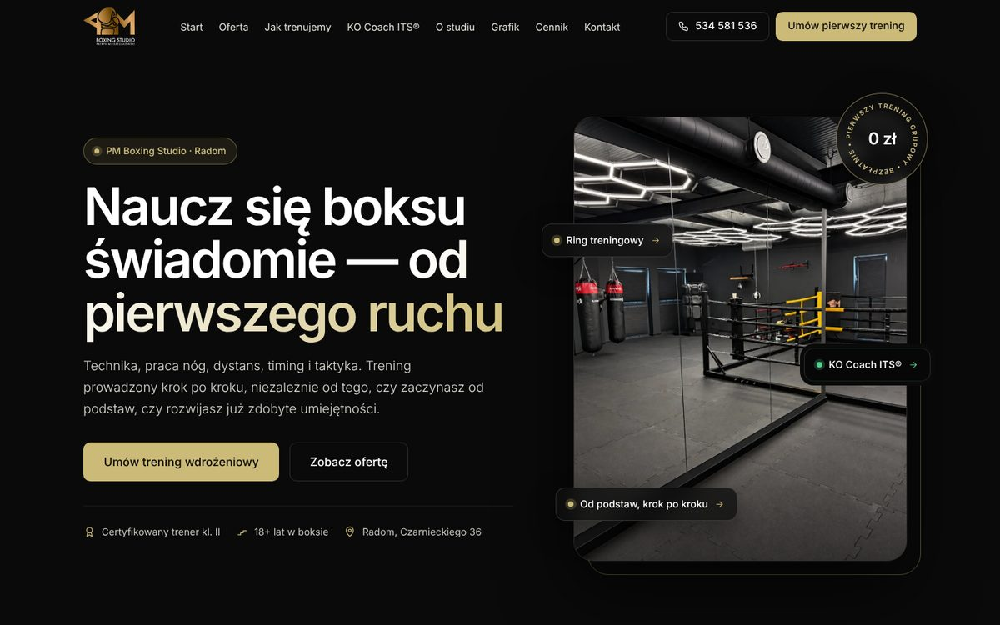
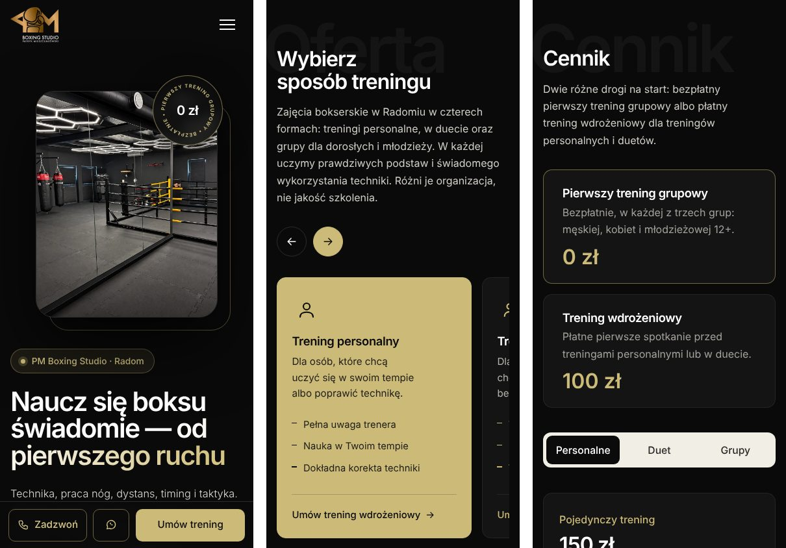

# PM Boxing Studio – motyw WordPress

Motyw WordPress dla studia boksu PM Boxing Studio w Radomiu (treningi personalne, w duecie i grupowe dla dorosłych oraz młodzieży 12+).

**Projekt i wdrożenie:** Mateusz Dams · [dams.mateusz@gmail.com](mailto:dams.mateusz@gmail.com) · [portfolio](https://mateusz-dams.github.io/)

| | |
|---|---|
| **Podgląd na żywo** | [mateusz-dams.github.io/pm-boxing](https://mateusz-dams.github.io/pm-boxing/) – statyczna kopia wygenerowana z motywu |
| **Strona w działaniu** | [pmboxingstudio.pl](https://pmboxingstudio.pl/) |
| **Landing pod reklamy** | [Trening wdrożeniowy](https://mateusz-dams.github.io/pm-boxing/trening-wdrozeniowy/) |

## Co robi motyw

- **Strona główna z 17 sekcji** (oferta, pierwszy krok, dla kogo, metoda treningu, KO Coach ITS®, o studiu, inspiracje, sala, opinie, grafik, cennik, partnerzy, FAQ, kontakt) – każda sekcja to blok edytowany w panelu (Secure Custom Fields), a **menu buduje się samo z kotwic sekcji**, identyczne w nagłówku i stopce.
- **Landing pod kampanie reklamowe** (`/trening-wdrozeniowy/`) z własnym zestawem sekcji, skupiony na jednym celu – płatnym pierwszym treningu.
- **Cennik w zakładkach** (personalne, duet, grupy) i grafik zajęć grupowych.
- **Formularz zgłoszeń** z walidacją, ochroną przed spamem (honeypot, czas wypełnienia, limit z jednego IP), wysyłką przez SMTP, automatyczną odpowiedzią i **przekazywaniem leadów do własnego CRM**.
- **Zgoda na cookies (Consent Mode v2)** – GA4, Google Ads i Meta Pixel ładują się dopiero po zgodzie; zdarzenia konwersji z formularza i telefonów.
- **SEO:** tytuły i opisy z panelu, Open Graph, dane strukturalne JSON-LD (firma, godziny otwarcia, FAQ).
- **Strony prawne** (polityka prywatności, regulamin, polityka cookies) wypełnione danymi spółki od razu po instalacji.
- Pełna treść domyślna w motywie – po instalacji strona jest kompletna, bez ręcznego uzupełniania.

## Technologie

PHP 7.4+ · WordPress · Secure Custom Fields (pola elastyczne) · HTML · CSS bez frameworka · JavaScript bez bibliotek · Google Consent Mode v2 · JSON-LD.

## O podglądzie na żywo

Podgląd to statyczny HTML wygenerowany z tego motywu – ten sam kod i wygląd, bez bazy danych WordPressa. Formularz sprawdza pola, ale zamiast wysyłki pokazuje informację, że to kopia. Kopia nie zawiera kodów pomiaru ani połączenia z CRM i ma znacznik `noindex`, żeby nie konkurowała w wyszukiwarce z oryginałem.
